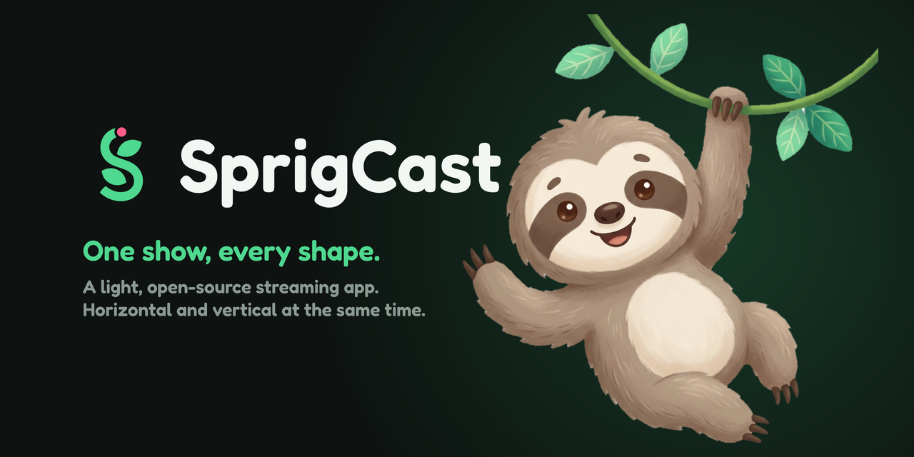

# SprigCast



A lightweight, open-source streaming app for Windows, in the spirit of OBS, Meld and Streamlabs.
SprigCast renders a **horizontal** and a **vertical** canvas at the same time, and each output
(Twitch, TikTok, a recording) streams from the canvas you choose. One show, every shape.

Version 0.2.0. See [CHANGELOG.md](CHANGELOG.md) for what changed and what has been tried on a real PC.

## Install

Download `SprigCast-Setup-<version>.exe` from the [latest release](https://github.com/surakage/sprigcast/releases/latest)
and run it. New to SprigCast? The [user guide](docs/user-guide.md) walks you from install to your first stream,
and says how to send a problem report.

The installer isn't signed yet, so Windows may show "Windows protected your PC". Choose **More info**, then
**Run anyway**. The file's fingerprint is in `SHA256.txt` on the same release page.

## Community

Join the [SprigCast Discord](https://discord.gg/fgMD33XrhM) to ask questions, report bugs, share ideas and show off
your stream.

## What it needs

- Windows 10 (version 1809 or newer) or Windows 11, 64-bit
- A graphics card with OpenGL 3.3. NVIDIA (NVENC), AMD (AMF) and Intel (Quick Sync) encoders are used when
  there; without one, SprigCast encodes on the CPU (x264).
- 4 GB of memory works for one 720p30 canvas; 8 GB or more for both canvases.

## Run it from the source code

For developers. You need [uv](https://docs.astral.sh/uv/), Git, and the FFmpeg CLI for the test stream:

```powershell
winget install astral-sh.uv Git.Git Gyan.FFmpeg
```

### Run it

```powershell
git clone https://github.com/surakage/sprigcast
cd sprigcast
uv sync                 # installs Python 3.12 and every library into .venv
uv run sprigcast-check  # M0: confirms PyAV can encode on your NVIDIA GPU
uv run sprigcast        # opens the app
```

To prove your stream key and network work before streaming from the app itself:

```powershell
uv run sprigcast-teststream --service twitch            # 1280x720 test pattern and tone
uv run sprigcast-teststream --service twitch --vertical # 720x1280
```

The key is typed at a hidden prompt and is never saved.


## Using the app

SprigCast has two screens. Switch with the buttons at the top left, or Ctrl+1 and Ctrl+2.

- **Blooms and sprigs.** A *bloom* is a scene that goes on air (Starting soon, Gaming, Be right back).
  A *sprig* is a reusable part, like a webcam frame or an alerts box, that you drop into blooms.
  Change a sprig once and every bloom that uses it changes, on both canvases. Sprigs can hold other sprigs.
- **Live (Ctrl+1)** is for running the show. The stage shows what's on air. Under it are three cards:
  *Blooms* (one button per bloom, with its hotkey), *Sound* (your sounds grouped as Voice, Game, Alerts,
  Music and Other) and *Transitions*. On the right are *Chat* and the *Go live* card with Record, Clips
  and your Destinations. Right-click the stage for *Full screen on…* another monitor.
- **Build (Ctrl+2)** is for making blooms. The library on the left has Horizontal and Vertical tabs, your
  blooms and sprigs, and the shared Sound list. The middle shows the bloom you're editing, which is not on
  air until you pick it in Live. On the right, *Inside* lists what the bloom holds and the inspector folds
  open with position and size. Drag to move, drag a handle to resize, hold Alt to crop. Undo and redo work
  as usual. New here? The *starter kit* (Tools menu) builds a first set of blooms from a few choices.
- **Sources**: display and window capture, camera (with color looks and shapes), image, color, text,
  browser page (right-click *Interact…* to click in it), media files (video and sound), chat, and sprigs.
- **Sound** belongs to the whole show, not one bloom, so it never plays twice when both canvases are live.
  Each sound has a *Tune* page with filters, and you pick which tracks it goes to: Stream, Recording,
  Voice or Clips. Turn on *Mic first* to dip other sounds while you talk.
- **Chat** mixes Twitch and YouTube in one panel. You can reply on Twitch and put chat on
  your stream as a source.
- **Settings** (Ctrl+,): General, Stream, Output, Audio, Video, Hotkeys, Connections, Advanced and Plugins.
  Stream keys are saved in Windows Credential Manager, never in the scenes file.
- **Optimize for this PC** runs on first start. It checks your PC and upload and suggests the heaviest
  settings that will run clean. Run it again any time from the Tools menu.
- **Stream doctor** (Ctrl+Shift+D) checks your setup before you go live. **Stats** is Ctrl+Shift+S, and
  the command palette (Ctrl+K) finds any bloom, setting or action by typing.
- **Control from other apps**: Streamer.bot, Stream Deck and your own scripts can drive SprigCast. See
  [docs/control-api.md](docs/control-api.md).

Logs, a report for each stream and crash reports go to `Documents\SprigCast\Logs`.
Scenes save automatically to `scenes.json` in your AppData folder; Help → About SprigCast → Licenses opens the list.

## Plugins

A plugin is a Python file that adds a new source type. The full guide is [Build your own plugin](docs/plugins.md). *Tools → Plugin store → Open plugins folder* (also under *+ → Plugins*) opens the folder
(`%LOCALAPPDATA%\Slothbloom\SprigCast\plugins`). Every `.py` file there loads at startup; files whose
name starts with `_` are skipped. Plugin sources appear under *Sources → + → Plugins*.

The first launch puts an example there, `countdown_example.py`, a "Starting in 4:59" countdown built on
the text source. A minimal plugin looks like this:

```python
from sprigcast.core.source import register
from sprigcast.sources.text import TextSource

@register("shout")
class ShoutSource(TextSource):
    label = "Shout"                                   # name in Sources → + → Plugins
    defaults = {**TextSource.defaults, "text": "hi"}  # fields in its Settings dialog

    def _current_text(self):
        return self.settings.get("text", "").upper() + "!"
```

For anything other than text, subclass `sprigcast.core.source.Source` and implement `size` and
`video_frame()` (return an RGBA NumPy array when the picture changes, `None` otherwise) or
`audio_samples()`. Installed packages can also register plugins through a `sprigcast.plugins` entry point.
Plugins can add audio filters too, with `sprigcast.core.filters.register_filter` (see the docstring there).
A plugin that fails to load is named in the status bar and in *Tools → Plugin store*, and skipped. Plugins run with the same rights
as SprigCast, so only install ones you trust.


## Project layout

```
src/sprigcast/
  core/      scene collection model (canvases, sources, blooms, outputs), Source base class, filters, events
  render/    moderngl compositor and the render engine thread
  sources/   built-in sources: capture, camera, image, color, text, browser, media, chat, sound, sprigs
  audio/     mixer that combines sounds into 48 kHz stereo tracks
  output/    recorder, replay and clips, streamer, our own NVENC encoder, Twitch Enhanced Broadcasting
  chat/      Twitch, YouTube and Kick chat
  control/   the control API (SprigCast's own and the obs-websocket compatibility mode)
  app/       PySide6 windows: Live and Build screens, settings, wizard, theme and art
  plugins.py loads source plugins from the plugins folder and entry points
  tools/     sprigcast-check, sprigcast-teststream and sprigcast-memcheck
  data/      default scene collection used on first run
packaging/   Windows installer (Inno Setup) and its build script
tests/       pytest suite (GPU tests skip when no OpenGL context is available)
```

Run the tests with `uv run pytest`.

## Releases

Each release is listed in [CHANGELOG.md](CHANGELOG.md). To make one: bump the version in `pyproject.toml`
and `src/sprigcast/__init__.py`, move the changelog's "not released yet" to the date, then push a tag like
`v0.2.0`. The tag builds the installer on GitHub.

Running the *Windows installer* workflow without a tag makes a test build. It says so wherever SprigCast shows
or logs its version ("0.2.0 test build 44932007527 (eafa358)"), so a log or a problem report always names
the build it came from.

## License

GPL-3.0-or-later. See [LICENSE](LICENSE). The installer also puts `LICENSE.txt` and
`THIRD-PARTY-NOTICES.txt` (every bundled library with its license, made by `packaging/notices.py`) in SprigCast's
folder.
